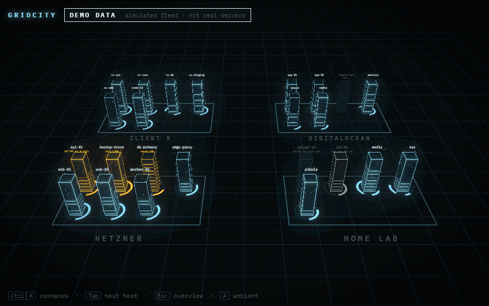
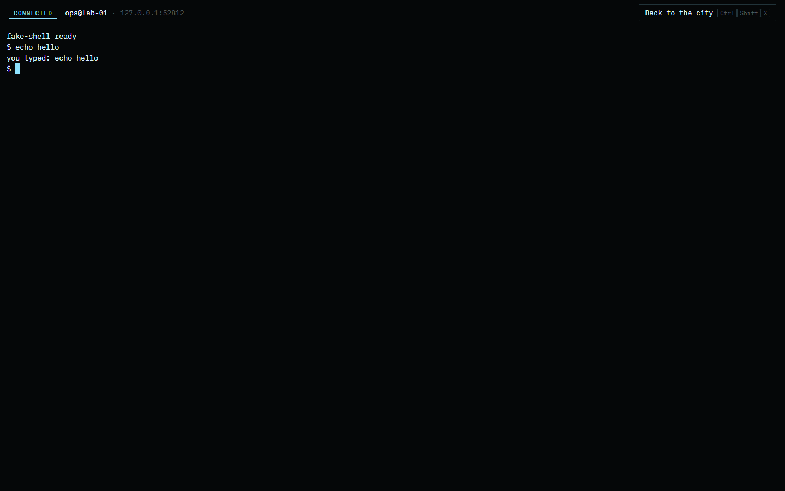

# GRIDCITY

**Your servers as a living city of light.** A local-first infrastructure tool: every SSH host
becomes a tower whose light tells the truth about it, and you can dive into any tower for a real
terminal. Databases (PostgreSQL, MySQL/MariaDB, MongoDB, Redis, SQL Server, SQLite), AWS RDS and
S3-compatible buckets join the city as buildings of their own.



- **Truth first.** Every light maps to exactly one metric. An offline server is dark and still;
  data that stopped arriving freezes and greys out with a "last seen" label. Nothing is ever
  faked. See [docs/VISUAL_LANGUAGE.md](docs/VISUAL_LANGUAGE.md).
- **Local first.** Runs on your machine, listens on `127.0.0.1` only, connects outward to your
  servers. No cloud, no account, no telemetry, no CDNs.
- **Your secrets stay yours.** SSH uses your ssh-agent or a key file path; private keys and
  passphrases are never stored. Database passwords, access keys and the alert webhook you paste
  in the app are saved encrypted on your machine only (never in a config file, never in logs).
  Unknown or changed host keys are refused, never auto-accepted.
- **The world is a map, never a gate.** Everything you can do with the mouse works from the
  keyboard (Ctrl/Cmd+K).

> **Status: v0.1 complete.** Live SSH metrics, the 3D city, real terminals, intro, ambient mode
> and audit log. Remote hosts must be Linux. See the [brief](docs/BRIEF.md) for the vision.

## Try it in one command

Requires **Node.js 22.12+** (24 recommended) or **Docker**.

```bash
npm install
npm run demo
```

Open the URL printed in the console (it contains the session token, and stays the same across
restarts, so you can bookmark it; `--new-token` replaces it). This serves a
**simulated fleet** (always labelled DEMO DATA) so you can explore without any SSH setup.
It behaves like a real one: load rises and falls through the day, and every so often a server
runs a busy job (turns degraded, then recovers), gets a traffic surge, leaks memory until its
service restarts, or reboots (offline for a few seconds, then back with fresh uptime). To watch it
at four times the speed, open the in-browser demo with `?source=demo&poll=500`.

With Docker instead: set `DATA_MODE=demo` in `.env`, then `docker compose up --build`.

## Use it with your servers

```bash
npm install
npm run dev
```

Your hosts live in `hosts.yaml`, created with a commented example on first start:

| Platform    | Location                         |
| ----------- | -------------------------------- |
| Linux/macOS | `~/.config/<project>/hosts.yaml` |
| Windows     | `%APPDATA%\<project>\hosts.yaml` |
| Docker      | `./config/hosts.yaml`            |

(`<project>` is `PROJECT_NAME` in lowercase.) Edit it any time: the running app reloads it live.

```yaml
hosts:
  - id: web-01
    name: web-01
    address: 203.0.113.10
    user: ops
    district: Hetzner # one district per value
```

Or import every concrete host from `~/.ssh/config`, either from the empty-city screen and the
command palette, or from a terminal (safe to run again):

```bash
npm run import-ssh-config
```

**Easiest: Connect a server.** Press Ctrl+K and choose **Connect a server…** (or the button in
the empty city). Pick **where the server is** and type its address, then:

| Where                                 | What you need                       | User name                                    |
| ------------------------------------- | ----------------------------------- | -------------------------------------------- |
| AWS (EC2, Lightsail), Oracle Cloud    | the key file (`.pem`/`.ppk`)        | found for you (`ubuntu`, `ec2-user`, `opc`…) |
| Google Cloud                          | your key, pasted in the console     | the one you type (`you@address`)             |
| Azure, DigitalOcean, Hetzner, any VPS | the key you chose, or the password  | `azureuser` / `root` by default              |
| Your own server                       | the password once                   | yours (`you@address`)                        |
| Private server behind a bastion       | the key, plus the jump host address | per server ("Reach it through a jump host…") |

The steps:

1. **Trust:** the app shows the server's fingerprint. Compare it and confirm; it is added to
   your `known_hosts`, like answering "yes" in `ssh`.
2. **Key:** pick a key from your ssh-agent or `~/.ssh`, **upload a key file** you were given (an
   AWS/cloud `.pem`, a PuTTY `.ppk`, or an OpenSSH `id_*`), or let the app create one. Uploaded
   keys are copied into your SSH folder; `.ppk` files are converted to OpenSSH format. Cloud
   servers usually already accept their key, so there is no password step. **Copy public key**
   gives you the line to paste into a provider's console (Google Cloud gets its `user:key` form).
3. **Install:** if the server doesn't accept the key yet, enter the password **once**. The app
   adds your public key to the server's `authorized_keys`; the password is never saved.
4. **Done:** the server is saved to `hosts.yaml` and lights up.

**Doing it by hand instead:** each host must be in `~/.ssh/known_hosts` (connect once with `ssh`
and verify the fingerprint), and your key must be in a running ssh-agent (`ssh-add`), or set
`auth: { method: keyFile, path: ~/.ssh/id_ed25519 }` for an **unencrypted** key. On Windows the
built-in OpenSSH agent works. `npm run add-host -- user@address` tests and saves one host.

For production use: `npm run build && npm start` (single port, serves the built app).

**Docker with real servers:** plain `docker compose up --build` is enough. Keys and trusted
fingerprints made in the app are kept in the data volume (`/data/ssh`), so restarts and rebuilds
never lose them (`docker compose down -v` deletes them). To use your own `~/.ssh` and ssh-agent
instead, copy `compose.ssh.example.yaml` to `compose.ssh.yaml`, keep your platform's block, then:

```bash
docker compose -f compose.yaml -f compose.ssh.yaml up --build
```

## Databases, RDS and object storage

**In the app (no config files needed):** Ctrl+K → **Connect a database, bucket, probe or
balancer…**. Pick the kind, fill a short form, **paste the password or access keys**, press **Test
connection** (one real read-only poll shows what it can see, or why it can't), then **Add to the
city**. Credentials are saved encrypted on this machine (see below); `resources.yaml` only gets a
reference such as `passwordSecret: orders-db.password`. A focused resource has **Edit** (name,
district, tags, a new password or keys) and **Remove** (which also deletes its saved credentials).
Prefer environment variables or files? They are under **Advanced** in the same form.

**Or by hand:** add them to `resources.yaml`, next to `hosts.yaml` (created with a commented example on first
start, reloaded live). Each kind is watched by one connector built on the standard open-source
library for it, and gets its own building in the city:

| Kind                                 | Library                                              | Building                  |
| ------------------------------------ | ---------------------------------------------------- | ------------------------- |
| PostgreSQL                           | `pg`                                                 | drum (3 stacked discs)    |
| MySQL / MariaDB                      | `mysql2`                                             | drum                      |
| MongoDB                              | `mongodb` (official)                                 | drum                      |
| SQL Server                           | `mssql`                                              | drum                      |
| SQLite (a file on this machine)      | `better-sqlite3`                                     | drum                      |
| Redis / Valkey                       | `ioredis`                                            | hexagonal prism           |
| AWS RDS (every instance in a region) | `@aws-sdk/client-rds` + `@aws-sdk/client-cloudwatch` | drum in a thin cage       |
| S3, DigitalOcean Spaces, MinIO, R2   | `@aws-sdk/client-s3` with a custom endpoint          | warehouse, one per bucket |

```yaml
resources:
  - kind: postgres
    id: orders-db
    host: db.internal
    user: monitor # GRANT pg_monitor TO monitor;
    passwordSecret: orders-db.password # pasted in the app, stored encrypted, never here
  - kind: postgres
    id: reports-db
    host: db.internal
    user: monitor
    passwordEnv: REPORTS_DB_PASSWORD # or: read it from an environment variable
  - kind: redis
    id: cache
    host: 10.0.0.7
    passwordFile: ~/.secrets/redis # first line of the file
  - kind: rds
    id: aws-prod
    region: eu-west-1 # your normal AWS credentials or `profile:`
  - kind: s3
    id: media
    provider: spaces
    endpoint: https://blr1.digitaloceanspaces.com
    accessKeyIdEnv: SPACES_KEY
    secretAccessKeyEnv: SPACES_SECRET
```

What you see: up/down, connections against the maximum, queries per second, slow queries,
replica lag, cache hit ratio and size for databases; CPU, free storage, connections, IOPS and
replica lag from CloudWatch for RDS; object count, size, growth per hour and reachability for
buckets. Anything an engine (or your user's grants) does not expose shows as a dash, never as
zero. Click a building or find it in Ctrl+K for its panel. The demo has DEMO DATA equivalents of
every kind.

Test the connectors against real instances in Docker: `npm run test:connectors`.

## Districts, probes, load balancers and what runs on your servers

A **district** holds anything, the way a VPC or a provider account does: EC2 servers next to
their RDS instances, the S3 bucket and the load balancer in front. Hosts and resources name their
district with the plain `district:` label; `districts.yaml` (next to `hosts.yaml`, optional)
adds the provider, region and a line of description. Click a district name on the floor, or pick
it in Ctrl+K, for its panel: how many buildings are online, degraded, offline or stale, what lives
inside, and which links cross its border. **R** opens the runbooks for every server in it.

```yaml
districts:
  - name: AWS Mumbai
    provider: aws # aws | gcp | azure | digitalocean | hetzner | oracle | cloudflare | home | onprem…
    region: ap-south-1
    description: Production VPC: EC2 behind the ALB, RDS and the media bucket.
```

**Probes and load balancers** join the city through `resources.yaml` or Ctrl+K → **Connect a
database, bucket, probe or balancer…**:

| Kind           | What it watches                                                                                           | Building                      |
| -------------- | --------------------------------------------------------------------------------------------------------- | ----------------------------- |
| `http`         | An endpoint checked from this machine: status, round trip, redirects, TLS certificate expiry and issuer   | beacon (thin spire)           |
| `tcp`          | A port: open or not, connect time, optional TLS certificate and banner                                    | beacon                        |
| `loadbalancer` | AWS ALB/NLB: state, healthy targets, requests/s, target response time, 5xx (CloudWatch), target addresses | gate (low wide slab, 6 bands) |

A slow endpoint pulses fast (round trip over 1.5 s turns it amber), a certificate expiring within
14 days turns the beacon amber, an unexpected status or a refused connection turns it dark. A gate
lights one band per healthy share of its targets; one unhealthy target makes it amber.

**Service discovery.** Every 30 s (configurable, `discoveryIntervalMs`) each connected server
answers one more read-only script: listening ports with the process when visible (`ss`), Docker
containers and their state (`docker ps`, when this user may), failed systemd units, whether a
reboot is required, pending updates on Ubuntu, and the TCP connections it has open. The host
panel shows all of it under **Services**; a restarting container, a failed unit or pending
security updates are called out.

**Topology.** The floor shows who talks to whom as flowing light between buildings, from the user
to the used. Three honest sources, nothing guessed: `dependsOn: [ids]` on a host or resource
(declared), connections really seen on a server that match another building's address and port
(observed; they fade when no longer seen), and the targets a load balancer reports (balances).
Both panels list links under **Talks to**; the district panel lists the ones crossing its border.

**Runbooks** (R, or Ctrl+K → "Run a runbook"). Commands you type a hundred times, saved once in
`runbooks.yaml` and run on one server or many: pick servers by district or tag, see exactly what
will run, confirm, and read one row per server with the exit code and output. A handful of
read-only diagnostics ship built in (top processes, what fills the disk, listening ports, failed
services, containers, recent errors, pending updates, who is connected, TLS certificates on the
server); an entry with the same id replaces one. "A command, this once" runs anything you type.
Every run lands in the audit log (command, servers, exit codes).

```yaml
runbooks:
  - id: restart-nginx
    name: Restart nginx
    command: sudo -n systemctl reload nginx || sudo -n systemctl restart nginx
    match: { tags: [web] } # optional; every server when omitted
```

**Alerts.** Settings → **Desktop notifications** tells this browser when a server or resource goes
offline, degraded, or recovers (real data only). For Slack, Discord, ntfy or anything that takes
JSON, paste its URL in Settings → **Webhook** (saved encrypted; **Send a test** checks it): the
server posts each transition, with a quiet minute per target so a flapping host does not flood the
channel. (`ALERT_WEBHOOK_URL` in `.env` still works for scripted setups.) AI agents see the same picture:
`list_servers` now includes the discovered services, and `list_resources` the probes and balancers.

## Let an AI work on your servers

Use the AI you already have. Nothing is wired to one vendor's API, and **every command an AI
wants to run pops up for you to approve first**, showing the exact command, the server and the
AI's reason: **Allow**, **Allow all on this server** (until restart) or **Deny**. Every command
that runs, and every one you deny, goes in the audit log.

**Claude Code, with your Claude subscription (MCP).** Press Ctrl+K → **Ask an AI agent…** →
_Use Claude Code with your Claude subscription_ → **Copy command**, and run it once. It looks
like this (the copied one already contains your token):

```bash
claude mcp add --transport http gridcity http://127.0.0.1:4600/mcp --header "Authorization: Bearer <token>" --header "X-Agent-Client: Claude Code"
```

Then ask Claude Code things like "which of my servers is running out of disk?". It sees the
city's servers (`list_servers`) and runs commands (`run_command`) that you approve in the city.
Any other MCP app (Cursor, Codex CLI, Claude Desktop through a bridge) can use the same URL and
header.

**Codex or Gemini CLI, inside the app (ACP).** In the same panel, pick an agent and press
**Start**. The app runs the vendor's open-source adapter through the
[Agent Client Protocol](https://agentclientprotocol.com) (the standard the Zed editor uses), and
you sign in with your own account:

| Agent               | Signs in with                                                              |
| ------------------- | -------------------------------------------------------------------------- |
| Codex (OpenAI)      | your ChatGPT subscription (a browser window opens), or `OPENAI_API_KEY`    |
| Gemini CLI (Google) | your Google account, or `GEMINI_API_KEY`                                   |
| Claude (API)        | `ANTHROPIC_API_KEY` only; for a Claude subscription, use Claude Code above |

Type, or press **Speak** and say it (the browser's speech recognition). The agent reaches your
servers **only** through the app's two tools, so its commands get the same approval cards. It
gets no files or shell on your computer, and any local action it asks for is refused. The first
start downloads the adapter with `npx` (pinned versions). In Docker the agent can't open a
browser to sign in: put an API key in `.env` (see `.env.example`).

Why no Claude login in the panel? Anthropic doesn't allow third-party apps to use Claude
subscription logins, so the app never asks for one. With MCP, Claude Code stays your own app.

## Reading the city

| You see                                 | It means                                                |
| --------------------------------------- | ------------------------------------------------------- |
| Cyan edges · amber edges                | online · over a threshold (CPU, memory or a disk)       |
| Edge pulse speed                        | CPU usage                                               |
| Horizontal light strips, filling upward | memory usage                                            |
| Segmented ring at the base              | each disk's usage; amber arc = that disk is nearly full |
| Particles rising around a tower         | network throughput (log scale)                          |
| Dark, motionless tower                  | **offline**; the HUD says why                           |
| Grey, dim, frozen tower, "last seen …"  | **stale**: data stopped arriving                        |
| Faint outline only                      | not measured yet                                        |
| Drum · hexagonal prism · caged drum     | a database · Redis · an RDS instance                    |
| Drum discs / prism strips lit upward    | connections used of the maximum                         |
| Pulse speed on a drum or prism          | queries (or commands) per second, log scale             |
| Low warehouse, roof cells lit           | a bucket; lit cells = stored size (log scale)           |
| Particles over a warehouse              | the bucket is growing (log scale)                       |

Every encoding, and the reasoning behind it: [docs/VISUAL_LANGUAGE.md](docs/VISUAL_LANGUAGE.md).

| Focus a host                           | Jack in                              | A refused host key                                   |
| -------------------------------------- | ------------------------------------ | ---------------------------------------------------- |
|  |  |  |

## History, Edit and Settings

- **History** (H, or "Fleet history" in Ctrl+K): when was a server overloaded or down? Every
  status change is recorded, so you see each incident (degraded or offline, its reason, when and
  for how long), a timeline over the range, and CPU, memory, disk and network charts with the
  server's warning threshold drawn in. Gaps mean no data, never zero. Kept for **7 days** by
  default.
- **Edit** (E, or the HUD button): rename a server, move it to another district, set tags, give
  it its own warning thresholds (for example warn at 75 % CPU on a small box), or remove it.
  `hosts.yaml` is updated in place with your comments kept; the id never changes, so the server
  keeps its place in the city and its history.
- **Settings** (Ctrl+K): how many days of history to keep (1–90), and the warning thresholds for
  every server (CPU and for how many polls, memory, disk, poll interval, when data counts as stale).

## Controls

| Key                 | Action                                                                               |
| ------------------- | ------------------------------------------------------------------------------------ |
| Click a tower       | Fly there and open its HUD                                                           |
| **Drag**            | Move across the city at the same zoom (right-drag or two fingers orbit, wheel zooms) |
| **Arrow keys**      | Pan the city                                                                         |
| **Ctrl/Cmd+K**      | Command palette: search hosts, every action                                          |
| **Tab / Shift+Tab** | Jump to the next / previous host                                                     |
| **Enter**           | Jack in: a real terminal on the focused host                                         |
| **Ctrl+Shift+X**    | Leave the terminal (Esc and Ctrl+K belong to the shell in there)                     |
| **Esc**             | Close panels, stop ambient mode, back to the overview                                |
| **A**               | Ambient mode: tour hosts that need attention (for a second monitor)                  |
| **H**               | History of the focused server (or every incident in the fleet)                       |
| **E**               | Edit the focused server: name, district, tags, its own warnings                      |
| **`** (backtick)    | Performance overlay                                                                  |

Also in the palette: lite mode (no bloom or particles, for weak GPUs, suggested automatically when
frames are slow), the audit log, importing from `~/.ssh/config`, and replaying the intro.

## What this does with your SSH access

- It opens one SSH connection **from your machine** to each host in `hosts.yaml`, using your
  ssh-agent or the key file you configured. Keys are read at connect time and never copied,
  logged or stored. Passphrases are never asked for.
- It verifies every host key against your `known_hosts`. Unknown, changed or revoked keys are
  refused and shown with their fingerprint; **nothing runs on that host**.
- It writes to your SSH setup only inside **Connect a server**, after you act: it appends a host
  key you confirmed to `known_hosts` (never replacing a changed one), may create a new key file
  (never overwriting one), and uses a password once, in memory, to add your public key to the
  server's `authorized_keys`.
- Every 2 seconds it runs **one fixed, read-only script** per host that reads `/proc`, `df` and
  `/etc/os-release`. It installs nothing and changes nothing on your servers.
- When you jack in, it opens an interactive shell on the existing connection. What you type runs
  with that user's permissions, exactly like `ssh`.
- It keeps an **append-only audit log** of connections, host key refusals and terminal sessions
  (opened/closed, with duration). It does **not** record what you type: capturing commands from a
  terminal is not reliable, and we don't pretend otherwise.
- An **AI agent** (Claude Code over MCP, or Codex/Gemini in the panel) runs a command only after
  you approve that exact command (or chose "allow all on this server" for this run of the app).
  Those commands are recorded in the audit log, with who asked and who allowed.
- The browser UI is reachable only from this machine, only with the session token printed at
  startup, and only from its own page (Host and Origin checks block other websites).

Details and limits: [docs/THREAT_MODEL.md](docs/THREAT_MODEL.md).

## What this does with your database and cloud access

- Each connector **only reads statistics**: `pg_stat_*` views (in a read-only session), `SHOW
STATUS`, MongoDB's `serverStatus`, Redis `INFO`, SQL Server DMVs (`ApplicationIntent=ReadOnly`),
  SQLite opened read-only, `DescribeDBInstances` and `GetMetricData`, and for buckets
  `ListBuckets`, `HeadBucket` and `ListObjectsV2`. It never reads your rows or objects, and never
  writes. Use a read-only monitoring user anyway; `resources.yaml` shows the grants for each.
- **Credentials you paste are stored encrypted, on this machine only.** AES-256-GCM in the local
  database; the key is a random 32-byte `vault.key` in the data folder (in Docker: the `/data`
  volume), or your own `SECRETS_KEY`. `resources.yaml` holds only references, and still refuses a
  `password:` key or a password inside a URL. Values are never logged, audited, sent back to the
  browser or shown to an AI. Honest limit: anyone who can read your data folder as you can read
  the key too, like a browser's saved passwords. Back up `vault.key` with the data folder; without
  it, saved credentials must be typed again.
- You can still use references instead: `passwordEnv` / `passwordFile`, `accessKeyIdEnv` /
  `secretAccessKeyEnv`, or an AWS `profile` (or the standard AWS chain when no keys are given).
  Error messages are scrubbed of secrets before they are logged or shown.
- Reachability changes are written to the audit log (reachable / unreachable, never every retry).

## Development

Docker is the reference environment for development and testing, so everyone gets the same
results.

| Task                                   | Docker                | Native             |
| -------------------------------------- | --------------------- | ------------------ |
| Dev servers with hot reload            | `npm run docker:dev`  | `npm run dev`      |
| All checks (format, lint, types, test) | `npm run docker:test` | `npm run check`    |
| Start the built server and verify it   | (part of docker:test) | `npm run smoke`    |
| Browser tests + review screenshots     | `npm run docker:e2e`  | `npm run test:e2e` |
| Re-record the README GIF               |                       | `npm run media`    |

Dev mode serves the web app on <http://127.0.0.1:4601> and proxies `/api` and `/ws` to the
server on port 4600. `?source=demo` runs the demo fleet entirely in the browser (no server);
`?hosts=50`, `?seed=3` and `?poll=500` tune it.

Docker renders with software WebGL, so for real frame times run the browser tests natively on
your GPU: `WORLD_GPU=1 npm run test:e2e` (first run: `npx playwright install chromium`).

More: [docs/ARCHITECTURE.md](docs/ARCHITECTURE.md) and [CONTRIBUTING.md](CONTRIBUTING.md).

## Environment variables

Defaults live in `.env.example` (committed). Put local overrides in `.env` (git-ignored). Real
environment variables win over both.

| Variable                 | Description                                              | Default            |
| ------------------------ | -------------------------------------------------------- | ------------------ |
| `PROJECT_NAME`           | Name of the project (single source of truth)             | see `.env.example` |
| `DATA_MODE`              | `real` (hosts.yaml over SSH) or `demo` (simulated fleet) | `real`             |
| `SERVER_PORT`            | API and production port                                  | `4600`             |
| `WEB_PORT`               | Vite dev server port                                     | `4601`             |
| `LOG_LEVEL`              | `fatal` … `trace`                                        | `info`             |
| `CONFIG_DIR`, `DATA_DIR` | Where hosts.yaml and the database live                   | OS conventions     |
| `SSH_DIR`                | Keys and known_hosts the app manages (`~/.ssh/<name>`)   | `~/.ssh`           |
| `KNOWN_HOSTS_FILE`       | known_hosts file the app trusts and writes to            | `SSH_DIR`'s        |

## Renaming the project

The project name is kept in one place, `PROJECT_NAME`. To rename the project:

1. Change `PROJECT_NAME` in `.env` and `.env.example`.
2. Change the title (first line) of this README.
3. Re-record the README media, which shows the name on screen: `npm run media`.

Code and config read `PROJECT_NAME` and never hardcode the name. Package names are generic
(`@app/web`, `@app/server`, `@app/shared`).

## Project structure

```
.
├── apps/
│   ├── server/          # Fastify server: SSH, metrics, state hub, terminals (loopback only)
│   └── web/             # Vite + React + three.js client; design tokens in src/design/tokens.ts
├── packages/
│   └── shared/          # Zod schemas, protocols, status rules, demo fleet
├── e2e/                 # Playwright: demo world + full stack against in-process SSH servers
├── docs/                # Brief, architecture, visual language, threat model, media
├── scripts/             # Smoke test, README media recorder
├── Dockerfile           # dev / build / runtime stages
├── compose.yaml         # Run the app (users)
├── compose.dev.yaml     # Develop and test (contributors)
└── compose.ssh.example.yaml  # Opt-in SSH access for the container
```

## License

[MIT](LICENSE)
