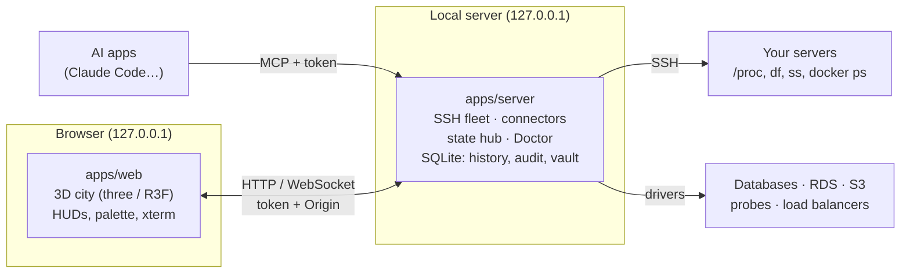

# Architecture overview

There is no hosted backend. One Node process on your machine connects **outward** to your
infrastructure and serves the UI on `127.0.0.1`.

## Packages

| Path              | Role                                                                                                                |
| ----------------- | ------------------------------------------------------------------------------------------------------------------- |
| `packages/shared` | zod schemas and types (wire protocol), status rules, layout, topology analysis, Doctor model, replay, the demo city |
| `apps/server`     | Fastify, ws, ssh2, better-sqlite3, the connectors, the Doctor, MCP and ACP for AI agents                            |
| `apps/web`        | Vite, React, three.js / React Three Fiber; 3D scene code kept apart from data logic                                 |
| `website`         | this documentation (Docusaurus)                                                                                     |

## The server

- **SSH fleet.** One persistent `ssh2` connection per server with keepalive and exponential backoff,
  strict `known_hosts`. Every 2 s one POSIX script on `sh -s` reads `/proc`, `df` and
  `/etc/os-release`; every 30 s a discovery script reads `ss`, `docker ps`, `systemctl --failed` and
  update state. Parsers are pure functions tested on captured output.
- **Connectors.** One file per resource kind behind a common interface (`resources()`, `poll()`,
  `close()`, optional `peers()`), each on the standard library for its engine.
- **State hub.** Holds every host and resource state, computes status and staleness, and pushes only
  what changed to every browser over WebSocket. It also builds the topology (declared, observed,
  balancer links) and hands status transitions to alerts.
- **The Doctor.** Ladder, rules, provider profiles and fix verification
  ([details](../guides/doctor.md)).
- **Storage.** SQLite: 30-second metric buckets, status transitions (incidents), sticky layout slots,
  app settings, the append-only audit log, and the encrypted credential vault.
- **AI.** An MCP endpoint for apps you run (Claude Code), and ACP for agents the app starts (Codex,
  Gemini CLI). Both go through one approval gate.

## The browser

A single zustand store mirrors server state through a pure reducer. `useCityModel` derives layout
and visual encodings (pure functions, unit tested); the scene only renders them, with one instanced
mesh per building shape and one draw call for all links, so the city stays fast at hundreds of
buildings. In time travel the same model is fed recorded frames instead of live state.

The full engineering notes live in
[`docs/ARCHITECTURE.md`](https://github.com/chapeee/GRIDCITY/blob/main/docs/ARCHITECTURE.md).
