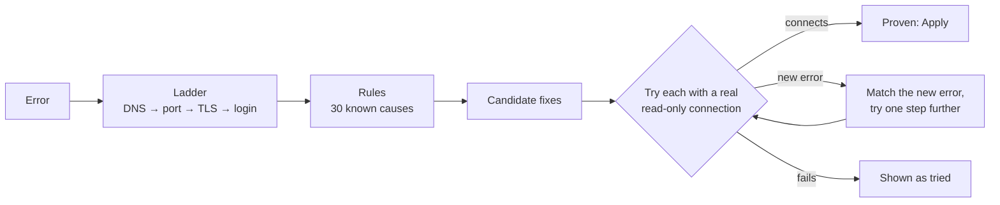

# The Doctor

A failed connection usually ends with a raw driver error. The Doctor turns it into **where the
connection breaks, why, and a fix that was already tried against your server**.

Open it with **D** (for the focused building, or for everything), from a building's panel
(**Diagnose**), or automatically when **Test connection** fails in a connect form.

## How it works



1. **The ladder.** It resolves the name (and says whether the address is public, private or this
   machine), opens the port (refused, or silently dropped by a firewall), and shakes hands for
   protocols that start with TLS. The first rung that fails is where the problem is.
2. **The rules.** About 30 rules written from the exact messages each driver produces: TLS required
   or unsupported, untrusted or expired certificates, wrong hostname, DNS, refused ports, firewalls,
   `localhost` inside Docker, rejected logins, users not allowed from your IP, unknown databases,
   Redis and MongoDB authentication, AWS keys, regions, clock skew, IAM permissions and HTTP status.
   See [Doctor rules](../reference/doctor-rules.md).
3. **Providers.** Managed services are recognised by hostname, with what they require.
4. **Proof.** Each proposed setting change is applied to a copy and tested with a real read-only
   connection (at most six attempts). When a change gets further but hits a new problem, the Doctor
   matches the new error and tries the next step on top of it.

## Reading a report

- **Ladder:** cyan worked, amber is a warning (an untrusted certificate), red failed, grey skipped.
- **Diagnoses:** ranked; each says how sure it is (_certain_, _likely_, _possible_) and why (the
  server's words, the failed rung, the provider).
- **Fixes:**
  - **proven**: it connected with this change. **Apply** saves it (after proving it once more).
  - **tried**: it did not help; the next line shows what the server said then.
  - **manual**: something only you can do, with the command to copy (a `GRANT`, a firewall rule).
  - **lower security** (amber): it works but weakens a protection, like skipping certificate
    checks. It needs a second click, and the safer manual option is listed beside it.

## Example: a managed MySQL that requires TLS

```text
✗ farm ddb  Connections using insecure transport are prohibited while --require_secure_transport=ON.
  → The server requires an encrypted (TLS) connection (certain)
      proven lower security  Turn on TLS, and skip certificate verification
      manual                 Paste the CA certificate
      tried, no              Turn on TLS   (then: self-signed certificate in certificate chain)
```

The best fix is to paste the provider's CA certificate (verification stays on). Without it, the
Doctor has proven that TLS without verification connects.

## What the Doctor never does

- It never changes anything by itself. You click **Apply**.
- It only changes connection settings (TLS, port, host, database, region…), never users, grants
  or anything on your servers.
- It never trusts an SSH host key, and never sends a password anywhere new.

## For servers (SSH)

For a server, the Doctor checks DNS and port 22, reads the SSH banner (is it really SSH on that
port?), runs the fleet's exact connection test, and gives the platform-specific steps: trust the
fingerprint, load your key in the agent, install it with `ssh-copy-id`, use the user a cloud image
asks for.

## For this machine

**D** with nothing focused also checks the machine GRIDCITY runs on: Node version, a writable data
folder, disk space, ssh-agent and its keys, `known_hosts`, broken config files, and `localhost`
entries inside Docker.

## Headless

```bash
gridcity doctor            # readable
gridcity doctor --json     # for CI and AI agents; exit code 1 when something needs attention
gridcity doctor --only orders-db,web-01
```

AI agents get the same report through the [`diagnose` MCP tool](../reference/mcp-tools.md).
