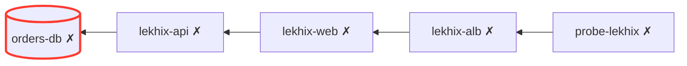

# Topology, root cause and blast radius

The floor of the city shows who talks to whom as lines of light. Pulses flow **from the user to the
used**: a web server's link to its database flows toward the database.

## Where links come from

Links are never guessed from names or districts. There are three sources:

| Kind         | Source                                                                           | Looks like                 |
| ------------ | -------------------------------------------------------------------------------- | -------------------------- |
| **declared** | `dependsOn: [ids]` on a server or resource (you wrote it)                        | faint, slow                |
| **observed** | a TCP connection really seen on a server, to another building's address and port | brighter, bows aside       |
| **balances** | a target an AWS load balancer reports                                            | bright, bows the other way |
| **probes**   | `dependsOn` on an HTTP/TCP probe: what it really hits                            | faint                      |

Observed connections come from [service discovery](./services.md). They fade out after four
discovery rounds without the connection. Links touching the focused building turn cyan.

```yaml title="hosts.yaml"
hosts:
  - id: lekhix-api
    address: 10.0.1.12
    user: ops
    dependsOn: [orders-db, rate-limit-cache]
```

## Blast radius

Every building's panel shows **Blast radius: N depend on it**: everything that uses it, directly or
through others, nearest first. Before you restart a database, you see what goes down with it.

## Root cause

When two or more things fail at once, a banner at the top names the **likely root cause**: a failing
building whose own dependencies are healthy, with how many other failures it explains. The Doctor
panel lists every root cause with a **Diagnose** button.



Here `orders-db` explains the four failures upstream of it: fix it first.

## For AI agents

`incident_report` returns the same analysis in one call (root causes, what each explains, what is
still up but at risk), and `get_topology` the links and blast radius of any building. See
[MCP tools](../reference/mcp-tools.md).
